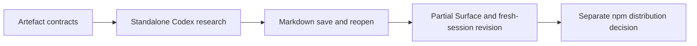

# n8r-surface critical path

The next installed-skill delivery agreed on 8 November 2026 is
[Capability and Bound Surfaces from workspace artifacts](surface-descriptions.md),
tracked by #50 → #51 → #52 under #17. Observed Surface is deferred. The earlier
CLI sequence and evidence below remain historical context, not this increment's
completion criteria.

The user updated delivery order on 5 November 2026: standalone Codex research,
Markdown save/reopen, then partial Surface generation and a complete fresh-session
revision proof. npm distribution ([#27](https://github.com/injectionator/n8r-surface/issues/27))
is separate and last. Lab integration stays in the n8r-labs repository.

The standalone conversation and Markdown continuation are merged in #33 and #34.
The current #17 increment adds paired structured research HTML and Surface JSON;
see the [short human check](getting-started.md) and
[versioned evidence](surface-revisions-verification.md). Broader host lifecycle,
live observations and consumer compatibility remain separate acceptance work.
The unfinished #16 source-overview branch is paused; no status subcommand is planned.

The sections below retain the wider requirements; their numbering is historical,
not the current delivery order. The
[command outcome specification](command-outcomes.md) governs implementation and
requires actual installed-runner proof beyond contract fixtures.

## 1. Define artefacts with concrete examples

**Issue:** [#15](https://github.com/injectionator/n8r-surface/issues/15).

Define a versioned experimental HTML research record and partial Surface graph.
Use synthetic sources for two unrelated products and show how selected findings
compose into one description. Establish which representation owns each fact in
the HTML, how manual edits are retained, and what a revision identifies.

Specify JSON/YAML preservation rules and examples with attributed nodes and
relationships, shared components, cycles, multiple connections, unknowns and
conflicting evidence. The [implementation decisions](implementation-decisions.md) select TypeScript,
Node.js 22/24/26, the `n8r-surface` npm package and npm/Node testing. The original
Responses API runner choice has been superseded by installed Codex for later CLI work. Runner implementation and credentials are not
needed by these offline contract checks.

Review the [compatibility contract](design.md#compatibility-contract) against
n8r-labs requirements: source access, human questions, artefact persistence,
version handling and continuation. Record gaps and supported boundaries using
public, synthetic examples. This review does not implement the application.

**Advance when:** the examples and checks give #16 and #17 concrete contracts,
including a documented route for n8r-labs to consume the shared core later.
Do not relabel existing illustrative fixtures as schema-conforming without
specifying and checking them.

The [command outcome spec](command-outcomes.md) must also give each subsequent
increment a user task, initial state, actual input and independently verifiable
result. Contract fixtures alone do not pass a command's acceptance case.

## 2. Prove the shared skill in the current harness

**Issue:** [#17](https://github.com/injectionator/n8r-surface/issues/17).

Use the [share/install and lifecycle procedure](researcher-skill.md) and record
the actual host/version, installed instruction identity, source access, output
and readback. The first package has no new runner or Lab dependency. A passing
manifest check or CLI installation does not establish a Work-mode invocation.

Lab adaptation remains separate work in n8r-labs. The standalone foundation and
research criteria below now precede it under the current user-selected order.

## 3. Resume the local CLI foundation

**Issue:** [#16](https://github.com/injectionator/n8r-surface/issues/16).
**Depends on:** #15.

Implement informational startup, missing-setup guidance, current-directory and explicit
source selection, and the configured artefact folder. Provide bounded tools to
list, read, create and revise records. Updates check the version read earlier,
retain a recoverable previous revision and complete atomically.

Implement in TypeScript and package the built CLI and required assets for npm.
Verify the installed tarball on supported Node.js versions independently of the
source checkout. Bun may support development/builds but is not an end-user
requirement. Package tests do not require publishing a release.

STARTUP-01 selects `~/.n8r/n8r-surface.json` for settings and
`~/n8r/artefacts` as the default corpus; `artefactRoot` in that file overrides it.
The overview displays the effective path; see [settings decisions](startup.md).
Keep AI selection separate from an optional Lab destination. Preserve invalid
configuration for repair; non-interactive commands must not wait on a prompt.

**Advance when:** synthetic tests cover first run, missing/unwritable paths,
unavailable runners, interrupted saves and human edits between read and write.
The executable is a local foundation at this point; it must not present an
unconnected discovery command as working research.

Start with [STARTUP-01](command-outcomes.md#startup-01-run-the-command-and-see-what-is-here):
given a configuration file and one saved artefact, running `n8r-surface` alone
shows readable non-private settings and their locations, one line for that artefact,
and known process status or an honest unknown. Verify this simple terminal example
before the more involved research paths; it requires no AI or Lab connection.

Exercise those behaviors through the installed command as well as internal
handlers. Record the applicable SETUP, INPUT, SCOPE, SAVE, HELP and
NONINTERACTIVE cases from [the outcome spec](command-outcomes.md#other-required-paths-and-failure-outcomes),
including actual before/after state and independent readback.

## 4. Demonstrate the standalone Researcher workflow

**Issue:** [#17](https://github.com/injectionator/n8r-surface/issues/17).
**Depends on:** #15 and #16.

Implement and version the shared Researcher skill in this repository, connecting
one supported AI runner and the local tools. No application extraction is required.
Support a human question, source inspection, saved findings, consequential
follow-up questions, corrections, continuation and JSON/YAML model output.
Reuse the skill already tried in ChatGPT with supplied documents. Host adapters provide access; they do not maintain separate
versions of discovery knowledge.

**Advance when:** a real supported-runner session completes the workflow on
permitted examples, the records survive save/reopen, and a second product works
without product-specific code. Compare facts, selections and gaps across the
CLI and external skill; generated wording need not match. Record any host
limitation and do not claim untested compatibility.

This completes the first standalone milestone. It does not establish that a Lab
importer accepts the output; that needs a separate named-consumer trial.

Use [E2E-01](command-outcomes.md#e2e-01-research-a-repository-and-produce-a-durable-record)
as the minimum complete path: locate the repo, load and follow the identified
Researcher instructions, interact with the human, save and reopen the actual
artefact. Exercise [E2E-02](command-outcomes.md#e2e-02-apply-the-same-path-to-librechat)
before claiming LibreChat research. Record actual tool/runner evidence and saved
state; do not substitute developer-authored findings or a fake runner.

## Work after the first milestone

The application adaptation preceding CLI completion belongs in the n8r-labs project: use an identified
Researcher revision with the Lab's own source access, AI, conversation and
storage adapters. Use the shared examples to verify research behaviour and
import an incomplete standalone record/definition, then continue it in the Lab.
Preserve identities, evidence, gaps and user decisions; report unsupported data.
Record the tested application and contract versions before claiming compatibility.

The [capability map](README.md) also retains remote Researcher execution,
additional AI runners, MessagePack and standalone executables. Create their
delivery issues when their consumer contracts and acceptance cases are concrete.

Keep browser editing, a general database, automatic two-way synchronisation,
advanced indexing and deployment automation outside this first path. Users can
choose their own editor; safe Researcher-assisted updates are sufficient here.

## Review and evidence

Each issue uses its own branch and draft PR in this repository. Link the primary
issue with `Closes #N` only when complete; use `Related to #N` for a partial
increment and retain its remaining scope. Link the overview with `Related to #13`.
Keep draft status
until review readiness is authorised; merging and releasing are separate steps.

Run the relevant [repository checks](../../CONTRIBUTING.md)
and the issue's acceptance cases. Distinguish file syntax, reference integrity,
model behaviour and actual consumer compatibility. Update the map and this path
when scope or dependencies change so the next task remains explicit.
