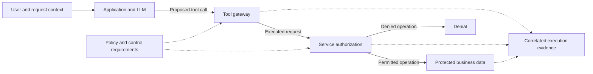

# Strategic direction: AI Surface security assurance

Agreed direction, 12 November 2026. Tracked in
[issue #64](https://github.com/injectionator/n8r-surface/issues/64).
This document captures the destination and proposed delivery milestones. It does
not claim an implemented framework, accepted assurance levels or runtime results.

## Purpose and primary reader

Provide a practical security assurance framework for people building and operating
AI Surfaces, supported by professional services, reusable guidance and tools.
The primary reader is the consultant advising a security engineer or architect,
who helps the system owner decide what protection is needed and whether the
evidence supports operation, release or a corrective change.

The consultant must be able to explain the expected security capabilities,
applicable controls, implementation options, verification procedures and remaining
risk in language the owner can act on. The owner selects or approves the policy,
required assurance level and any exceptions with that advice. Assessment records
identify the assessor and the basis for each judgment; automation supplies evidence
and repeatable checks without silently making the owner's risk decision.

The intended service is to define the security expected of an AI Surface, discover
how it is implemented, and demonstrate through observable testing whether the
running system meets those expectations. Retain the evidence needed to explain
its posture and verify improvements. A readable framework and a useful assessment
are deliverables in their own right; the tools support their production and reuse.

This is a strategic use of the independently usable AI Surface Model. There remains
one model. The framework must work across different compositions, including
applications, agents, models, tools, data services and their external dependencies.
Unknown or inaccessible service internals remain explicit coverage limits.

## From policy to implementation and observable verification

| Layer | Required content and intended use |
| --- | --- |
| Policy and security objectives | Protected assets, intended users and authority, threats, obligations, scope and acceptable behaviour. |
| Security capabilities and levels | Human-readable capability areas and versioned L1/L2-style profiles stating which requirements and verification obligations apply. |
| Controls | Requirement, rationale, applicability, responsible party, protected resources/paths, enforcement points, dependencies and exceptions. |
| Implementation guidance | Concrete steps and configuration requirements for named component versions and compositions; alternatives that satisfy the same intent. |
| Verification procedures | Static inspection and live probes/attacks, prerequisites, authorized scope, expected outcomes, required observation points and failure/inconclusive criteria. |
| Assessment and improvement | Findings, evidence, conformance, coverage, limitations, remediation and repeat verification against an identified successor setup. |

Security capabilities here mean abilities such as enforcing user authority; they
are not synonymous with a Capability Surface, which describes supported component
and integration possibilities. L1/L2 are intended framework concepts, not existing
levels or product ratings. Their control membership, applicability rules and
verification depth still need definition. Decide explicitly whether a level adds
controls, stronger evidence or both. Version policies and profiles so later changes
do not silently change earlier assessments.

Each control entry should let a practitioner answer: what is required, why it
applies, where it is enforced, how to implement it, how to verify it, and what
counts as sufficient evidence. A component's controls may depend on controls
provided by another service. Evaluate complete paths as well as isolated nodes.

## Bidirectional assessment of static and live Surfaces

Work downwards from policy to controls, implementation and tests, and upwards from
discovered components and behaviour to the requirements they support or violate.
Neither direction requires a complete inventory before useful work can begin.

Static inputs include repositories, documentation, inventories and configuration
artifacts. Live inputs include running instances, effective configuration, service
connections, user/role context, logs and permitted observations or probe results.
Bind these to the relevant component and relationship identities, source revisions,
effective setup, time and test Run. Repository configuration can differ from the
effective running setup; preserve and investigate that disagreement.

Keep these judgments separate:

- **Required:** a policy/profile makes a control applicable to an identified scope.
- **Claimed or configured:** documentation, code or instance configuration provides
  evidence about the implementation, with its own limitations.
- **Demonstrated:** a scoped observation or test supports or contradicts a claim
  about the running system under stated conditions.

These judgments complement Capability/Bound/Observed evidence distinctions; they
are not replacements or automatic conversions. Configuration does not establish
runtime effectiveness. Missing evidence is unknown, not proof of an absent
control; a supported finding of absence must explain the examined scope.

Link policy requirements to controls; controls to protected nodes, relationships
and paths; implementations to enforcement components and configuration; and
verification procedures/results to the exact claims and setup they assess. Users
must be able to navigate from a component to its controls and tests, or from a
control to every known implementation, uncovered path and outstanding question.

## Domain, identity and control-aware runtime paths

Assess the paths an LLM can assemble at runtime against the security framework.
A test needs business meaning: which actor, acting from which context, attempts
which operation on which resource, under which policy? HR records, CRM accounts,
financial transactions and clinical data introduce different permissions and
consequences. Trace authentication, authorization and accounting across the path,
including changes from the initiating user to delegated or service identities.

The circuit analogy describes how a request can connect tools, data and services
into an execution path. It is an explanatory view of the same AI Surface Model,
not a separate model or a claim that the LLM controls every connection. Host logic,
tool availability, permissions and external systems also determine execution.
The following synthetic diagram illustrates one candidate path, not live evidence:

The illustrated enforcement points are candidates to investigate; their presence,
coverage and effectiveness require evidence. A real path may branch, run in
parallel, retry, loop or invoke further agents. Finite tools do not imply a small
set of histories: arguments, state and repeated operations can produce an enormous
or unbounded execution space. Do not promise exhaustive testing of arbitrary
human inputs or every possible circuit.

Assess the intended protection of each technique against explicit requirements:
input constraints, actor/task-specific tool access, per-action authorization,
sequence/state restrictions, approval bound to the executed action, execution/data
budgets, and detection/interruption. These are candidate control families, not an
adopted catalog. Input filtering or an LLM guardrail must not receive credit for
service authorization without evidence that it enforces the relevant requirement.
Individually permitted operations may combine into a forbidden business outcome.

The assessment must identify which control held or failed. If the model proposes
a prohibited read and the service denies it, downstream authorization held for
that attempt even if a guardrail did not. If the model refuses after a tool has
retrieved protected data, investigate the retrieval and disclosure separately.
If the response invents a record without retrieval, assess integrity rather than
claiming demonstrated unauthorized data access. Prompt injection is one means of
exercising these boundaries; direct requests, retrieved content, tool outputs and
stateful sequences can test the same business rule. Existing probe engines can
supply inputs; the framework supplies context, expectations and evidence criteria.

### Proof, counterexamples and bounded tests

| Conclusion | Required basis and limit |
| --- | --- |
| Proved within stated assumptions | An identified property and explicit model/scope, justified assumptions and a suitable proof or exhaustive analysis of a bounded state space. Establish how the analyzed model corresponds to the deployed setup; a model proof alone is not proof of the whole live service. |
| Disproved by a counterexample | A traceable execution violating the exact claim under its applicable conditions. One valid counterexample defeats a universal claim, even if the behavior is intermittent; it does not establish prevalence or failure of unrelated controls. |
| Supported by bounded testing | Identified cases, repetitions, outcomes and observation coverage. Report the tested conditions and unexplored space; passing samples do not prove all paths safe. |
| Inconclusive or blocked | Missing prerequisites, ambiguous attribution or insufficient telemetry. State what evidence would resolve the judgment; no observed failure does not imply a pass. |

For probabilistic behavior, retain model/provider version where available, relevant
settings, prompts and source context subject to privacy rules, initial state,
identity/role, setup revision, attempts and observed outcomes. Record unknown
provider details and changes. Repeated trials can characterize the sampled
conditions; do not infer a general failure probability without a justified sampling
method. Keep a retained counterexample even if later attempts cannot reproduce it.

### Proposed Labs view: watch and replay the circuit

A proposed n8r-labs consumer capability is to draw observed execution paths as
events arrive and replay them afterwards. It should help the consultant see the
initiating and effective identities, proposed versus executed tool calls, data
movement, control decisions and resulting effects, with links back to the policy
and evidence. A denied operation may be an exercised enforcement point without
being a completed data-access path. A configured control without decision evidence
must not be displayed as an observed successful check.

Such a view depends on sufficiently correlated, authorized telemetry. Make missing
instrumentation, delayed events, uncertain ordering and inferred links visible;
chronological proximity alone does not establish causality. Describe observed data
movement only to the granularity supported by evidence, without exposing protected
payloads. Preserve the Run and effective setup so replay cannot silently substitute
today's configuration for the one tested. The visualization is a view onto evidence,
not proof of complete execution coverage.

This records a consumer outcome and evidence requirements only. Labs UI design,
instrumentation, event transport/storage and implementation belong in the separate
n8r-labs repository. A static evidence-linked path is enough for the first framework
slice; live animation is not a prerequisite for proving a bounded control failure.

## Demonstrating conformance and reporting posture

The distinguishing outcome is observable testing of control effectiveness.
Probes and attacks must test explicit expected behaviour, including legitimate
use, and retain enough downstream evidence to explain the result. A model refusal
alone does not establish that a tool made no prohibited request or disclosed no
protected data. Correlate initiating and effective identities, executed operations,
authorization decisions, returned data and effects where relevant.

For example, a tenant-isolation requirement leads to inspection of identity
propagation and authorization, then authorized cross-user retrieval probes on a
controlled composition. A successful prohibited read contradicts the control claim
even if configuration inspection passed. After a defensive change, repeat both
prohibited and legitimate access and preserve the original setup and evidence.
A passing test supports the exercised conditions, not every possible attack.
Missing telemetry or unavailable prerequisites produce an inconclusive or blocked
verification result, not a pass.

The strategic goal includes scoring a service against an agreed profile. Report
conformance, assessment coverage, evidence strength/freshness and critical failures
separately. A score must name its policy/profile version, applicable scope,
assessment time and evidence basis. Untested controls must not appear as passes;
exclusions and accepted exceptions must remain visible. Critical failures must not
be hidden by averaging many easy passes. Numeric formulas, weights, level gates,
expiry rules and treatment of exceptions remain design work; no current Surface
artifact earns a framework score merely by validating or being saved.

The consultant's report should show the target level, requirement-by-requirement
judgments, supporting and contrary evidence, gaps, prioritized corrections and the
owner's recorded decisions. Use concise defaults with explanations and evidence
within one request, following the [presentation guidance](product-direction.md#presentation-brief-by-default-explanation-within-reach).

## Existing work and proposed next milestones

Status snapshot: 12 November 2026. Milestones below are a recommended sequence,
not implementation authorization or release commitments. Close the existing
acceptance loop while developing the first bounded framework example.

| Work or milestone | Position and contribution | Evidence needed to advance |
| --- | --- | --- |
| Discovery and durable descriptions | Capability/Bound contract, standalone skill 0.1.11 and two-product verification merged in #53/#54/#58. These provide identities, relationships, evidence and revision preservation. | Retain the accepted bounded evidence; do not reinterpret it as security-posture acceptance. |
| Practical consultant intake | Incremental source discovery and fresh-session correction rehearsed in draft #63; installation handoff in draft #62. | User review of the saved brief and useful next enquiries; preserve source/configuration/runtime distinctions. |
| First framework slice | Next proposed milestone: one security capability, a small explicit control set, a provisional level profile, domain/identity context, implementation guidance and verification procedures with explicit proof/test limits. | A consultant and engineer can trace one policy requirement down to a test and a discovered fact back to the requirement, using a synthetic worked example. Approve the bounded profile before rating against it. |
| Static and configured assessment | Apply that slice to a known composition using the existing discovery path. LibreChat/VPS/Atlas is an existing motivating path, not a required architecture or verified posture. | Evidence-linked control applicability, implementation claims, gaps and proposed probes; independent source/configuration readback. |
| Observable runtime proof | Extend the [first value demonstration](product-direction.md#smallest-end-to-end-value-demonstration) with the selected control/profile and assessment record. Fixture and execution owner remain to be selected. | One discovered authority failure, a defensive change, prohibited/legitimate retests, downstream evidence attributing the result to a specific control, a retained runtime path and preserved before/after setup references. |
| Repeatable assessment and scoring | Derive the initial reporting/rating rules from the worked example, then exercise another composition without product-specific control meanings. | Explicit coverage and critical-failure rules; independent review can reproduce judgments from retained evidence and identify inconclusive cases. |
| Live path visualization | Proposed Labs consumer outcome: watch/replay observed circuits with identity and control context. No Labs implementation is included here. | Correlated events resolve to the same Run/setup and evidence; proposed/executed/denied actions, inferred links and telemetry gaps remain distinguishable. |
| Distribution and consumer integration | CLI #59 and scoped candidate #60 remain drafts; #60 is stacked on #59. Labs adaptation belongs in its own repository. | Separate experience acceptance, release decisions and named-consumer evidence; these are delivery channels, not substitutes for assurance proof. |

The narrow runtime demonstration is intended to become the first exercised path
through the framework, not the whole strategic destination. Broader control coverage, additional levels,
continuous reassessment and more implementations can follow evidence from that
path. Existing issues #13/#17/#27 retain their wider remaining scope.

## Standards and delivery boundaries

The separate [CycloneDX adoption direction, #66](https://github.com/injectionator/n8r-surface/issues/66)
and [draft #67](https://github.com/injectionator/n8r-surface/pull/67) establish the
inventory/exchange foundation and SBOM-first discovery direction. Inventory,
assembly and operational records should connect to controls and assessments.
Their existence alone does not establish effectiveness or conformance.

Investigate bounded mappings to CycloneDX 1.7 definitions/declarations and reference
mechanisms, and OSCAL control implementation and assessment concepts. CycloneDX
1.7 defines claims, targets and evidence; OSCAL describes component control
implementations and assessment records. See the
[CycloneDX 1.7 reference](https://cyclonedx.org/docs/1.7/proto/)
and [OSCAL model overview](https://pages.nist.gov/OSCAL/learn/concepts/layer/).
OSCAL is a mapping candidate, not an adopted dependency. Pin its selected version
before producing a mapping. Follow the [interoperability evidence requirements](../interoperability.md#evidence-for-compatibility);
no mapping, round trip or consumer compatibility is established by this strategy.

n8r-surface supplies discovery descriptions and the meanings required to connect
policy, claims and evidence. Execution owners supply authorized test/probe runs;
observability supplies correlated evidence. Labs application design remains in
its separate repository, with Lab-owned configuration and bindings. A manual
execution handoff can prove the first slice without a general telemetry platform.

The installed skill remains read-only with respect to target systems. This strategy
does not add runtime collection, attack execution, an Observed Surface contract,
a control catalog or a scoring engine. Each behavior change needs its own intent,
installed-product attempt or recorded blocker, implementation and verification.
Customer configurations, user data and raw telemetry remain in permitted private
storage; publish only approved sanitized evidence. Framework conformance claims
must stay within their assessed scope and do not imply certification.
