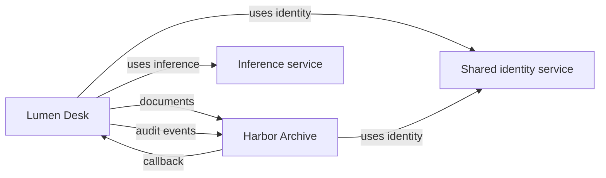

# Synthetic Researcher acceptance cases

These fictional products and documents exercise the
[experimental 0.1 contracts](../../docs/n8r-surface/contracts.md). They are not
LibreChat findings, AI-generated discovery results or a working integration.
No inference, credentials, network access or running target is needed to check them.

Lumen Desk is a fictional AI support-summary application. Harbor Archive is an
independent fictional document/event archive. A synthetic human selects a proposed
composition after researching both. The sources establish possible interfaces;
payload compatibility and effective configuration remain unverified.

| File | Case |
| --- | --- |
| [Lumen guide](sources/lumen-guide.md), [settings](sources/lumen-settings.md) | Conflicting batch limits of 10 and 25; inference model unknown. |
| [Lumen r1](lumen-r1.research.html) | Initial research; archive/identity selected, callback deferred. |
| [Pending manual edit](lumen-manual-edit.pending.html) | Deliberately invalid visible edit; embedded data remains r1. |
| [Lumen r2](lumen-r2.research.html) | Human-reviewed callback selection, preserving findings and opaque extension data. |
| [Harbor interface notes](sources/harbor-api.md) | Independent product with unknown authentication. |
| [Harbor r1](harbor-r1.research.html) | Useful incomplete research from one source. |
| [Harbor authentication note](sources/harbor-auth.md) | Second supplied source establishes an OIDC option. |
| [Harbor r2](harbor-r2.research.html) | Continuation keeps the authentication finding's identity and records a human selection. |
| [Selected JSON](composed.surface.json), [selected YAML](composed.surface.yaml) | Same partial graph, referencing the exact r2 records. |

Open a research HTML file in a browser to read its findings and inspect its embedded
data. The data owns all facts; rendering is a derived view. These checked fixtures
are inert, but arbitrary imported HTML must be validated before trusted rendering.

The separate [Capability and Bound examples](descriptions/README.md) exercise the
JSON-only `0.2` description contract. They do not convert these selected `0.1`
definitions into deployments.

## Selected composition



The graph has shared identity, a cycle, identified parallel edges and node/edge
attributes. All edges are declared only. The identity service's product and
inference version remain unknown. Configuration/secret requirements are explicit
local references without credential values. Attributes exercise known, unknown,
omitted, redacted, absent and out-of-scope states. The conflicting batch limit is
unknown in the selected definition and points back to both research claims.

The example vocabulary `urn:n8r:vocabulary:researcher-example` version `0.1` has
node terms `application`, `service`, `inference-service` and relationship terms
`sends-documents`, `sends-audit`, `notifies`, `uses-identity`, `uses-inference`.
These mean precisely the labeled roles/connections above, with no hidden protocol
or lifecycle behavior. They are not a general ontology or a consumer capability.

## Manual-edit case

The pending file changes only the visible callback-decision reason. Its original
embedded decision remains deferred. `readResearchHtml` must reject it as an
HTML/data conflict. It must not silently choose the old embedded data or assume
that visible prose establishes a structured decision.

The synthetic review resolves the intended change: include callbacks in the desired
composition, while retaining compatibility gaps. Lumen r2 records that selection,
its author/time/reason and a human note, then regenerates the visible projection.
Its parent digest pins r1; both earlier and pending files remain available.
This demonstrates a reviewed result, not an implemented automatic reconciliation
or persistence command.

## Run the checks

From the repository root, with a supported Node.js and npm:

```sh
npm ci
npm test
```

Dependency installation uses the npm registry. The tests themselves are offline.
They check source-byte hashes, internal references, exact external revisions,
HTML/data agreement, rejection of the pending edit, successor lineage, unknown
values and JSON/YAML equality. Semantic assertions verify the competing limits,
new authentication evidence and selected graph structure. These checks do not
verify an AI Researcher, facts about a real product or Lab compatibility.

The future #17 runner and external skill must use these same cases, including a
second source and human correction, and compare facts/choices/gaps rather than
exact generated wording. Later Lab import/continuation must retain incomplete
records, IDs, versions, provenance and extensions, and report unsupported meanings.

Machine-readable fixtures and their rendered research HTML use
[Apache-2.0](../../LICENSE). The synthetic source documents and this guide use
[CC-BY-4.0](../../LICENSE-DOCS); credit AI Surface Model contributors. All material
was created for these fixtures; no third-party product documentation is included.
